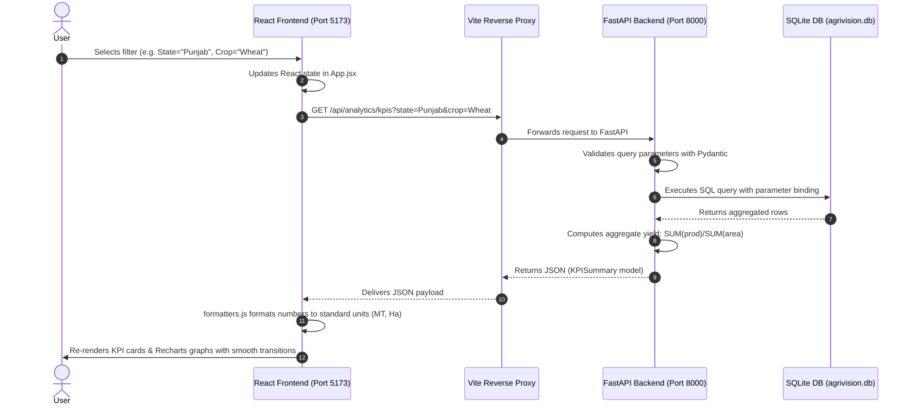

# AgriVision – Comprehensive Project Architecture & Technical Explanation

**AgriVision** is a full-stack, enterprise-grade Agricultural Crop Production Analysis System designed for monitoring, filtering, and analyzing historical crop production, cultivated area, aggregate yields, and climatic precipitation patterns across states, districts, and crop seasons.

---

## 1. Complete Project Folder Structure

```
agrivision/
├── README.md                                    # Project documentation & setup instructions
├── PROJECT_EXPLANATION.md                       # Complete technical & architectural deep-dive
│
├── backend/                                     # Python FastAPI Backend
│   ├── requirements.txt                         # Python package dependencies
│   ├── tests/
│   │   └── test_api.py                          # Pytest suite (11 integration & unit tests)
│   └── app/
│       ├── __init__.py                          # Package marker and version metadata
│       ├── main.py                              # FastAPI app entrypoint, CORS & lifespan seeding
│       ├── database.py                          # SQLite database engine, tables & index setup
│       ├── models.py                            # Pydantic data schemas & request/response validation
│       ├── crud.py                              # SQL queries, statistical aggregations & math logic
│       ├── data_loader.py                       # Synthetic historical data generator & CSV validator
│       ├── data/
│       │   ├── agrivision.db                    # Active SQLite 3 database file (4,105+ records)
│       │   └── demo_dataset.csv                 # Pre-generated seed dataset for portability
│       └── routers/
│           ├── __init__.py                      # Routers package marker
│           ├── metadata.py                      # Filter metadata endpoint (/api/metadata/filters)
│           ├── analytics.py                     # KPIs, trends, comparisons & scatter endpoints
│           ├── records.py                       # Paginated records & export endpoints
│           └── upload.py                        # CSV validation, commit & template endpoints
│
└── frontend/                                    # React 18 + Vite Frontend
    ├── index.html                               # HTML entry document (fonts, meta, dark background)
    ├── package.json                             # Frontend dependencies and npm scripts
    ├── package-lock.json                        # Exact npm package dependency tree lock
    ├── vite.config.js                           # Vite bundler configuration & backend API reverse proxy
    ├── tailwind.config.js                       # Tailwind CSS color palettes & theme extensions
    ├── postcss.config.js                        # PostCSS configuration for Tailwind and Autoprefixer
    ├── public/
    │   ├── favicon.svg                          # Sprout favicon
    │   └── icons.svg                            # Vector iconography
    └── src/
        ├── main.jsx                             # React root DOM rendering entrypoint
        ├── App.jsx                              # Central application shell, state hub & tab controller
        ├── index.css                            # Global CSS, Tailwind layers, emerald scrollbars
        ├── App.css                              # Component level helper styles
        ├── services/
        │   └── api.js                           # Axios API client & backend endpoint mapping
        ├── utils/
        │   └── formatters.js                    # Standard agricultural unit formatters (MT, Ha, mm)
        └── components/
            ├── Navbar.jsx                       # Top brand header, DEMO badge & action triggers
            ├── Sidebar.jsx                      # Collapsible navigation sidebar & mobile drawer
            ├── FilterBar.jsx                    # Cascading dropdown filters (State → District, etc.)
            ├── KpiCards.jsx                     # 4 Glassmorphism KPI cards with formula transparency
            ├── DisclaimerBanner.jsx             # Scientific disclaimer & data provenance banner
            ├── EmptyState.jsx                   # Graceful zero-result UI with reset trigger
            ├── UploadModal.jsx                  # Drag-and-drop CSV validator & database ingestor
            ├── ReportModal.jsx                  # Printable executive summary report & dataset exporter
            ├── Charts/
            │   ├── ProductionTrendChart.jsx     # Historical time-series ComposedChart (dual Y-axis)
            │   ├── StateComparisonChart.jsx     # Horizontal ranking bar chart (Production vs Yield)
            │   ├── CropDistributionChart.jsx    # Donut chart & crop percentage share breakdown
            │   ├── RainfallScatterChart.jsx     # Rainfall vs Yield scatter with Pearson r
            │   └── SeasonYieldChart.jsx         # Kharif, Rabi, Zaid, Whole Year seasonal comparison
            └── DataTable/
                ├── RecordTable.jsx              # Searchable, sortable microdata table with CSV export
                └── TablePagination.jsx          # Pagination controls and rows-per-page selector
```

---

## 2. Programming Languages, Frameworks, Libraries & Databases

### A. Programming Languages
- **Python (v3.14+)**: Powers the backend REST API, data aggregation engine, mathematical calculations (aggregate yield, Pearson correlation coefficient $r$), database management, and automated test suite.
- **JavaScript (ES Modules & JSX)**: Powers the dynamic user interface, reactive state management, asynchronous data fetching, and browser client rendering.
- **HTML5**: Base structure with accessible semantic markup in `index.html`.
- **CSS3 / PostCSS**: Modern stylesheet features, custom dark scrollbars, backdrop filters, and glassmorphism styling.
- **SQL (SQLite dialect)**: Relational schema creation, composite indexing, parameter-bound filtering, aggregations, and pagination.

### B. Backend Frameworks & Libraries
- **FastAPI (v0.156+)**: High-performance ASGI Python web framework with automated OpenAPI/Swagger documentation, strict request/response type validation, and dependency injection.
- **Uvicorn (v0.54+)**: Lightning-fast ASGI web server running FastAPI on `http://127.0.0.1:8000`.
- **SQLite 3**: Embedded transactional relational database stored in `agrivision.db`. Uses WAL (Write-Ahead Logging) and custom indexing for high-speed analytical queries.
- **Pydantic (v2.14+)**: Strict data schema modeling, input validation, and type-safe response serialization.
- **Pandas (v3.0+)**: Data processing and statistical transformations.
- **Python-Multipart (v0.0.32+)**: Streaming multipart form parser enabling CSV dataset file uploads.
- **Pytest (v9.1+) & HTTPX (v0.28+)**: Automated API integration and regression test suite.

### C. Frontend Frameworks & Libraries
- **React (v18.3+)**: Component-based UI library with reactive state hooks (`useState`, `useEffect`, `useCallback`, `useRef`).
- **Vite (v6.4+)**: Next-generation frontend bundler providing sub-second Hot Module Replacement (HMR) and optimized Rollup production builds.
- **Tailwind CSS (v3.4+)**: Utility-first CSS framework configured with custom dark forest (`#021a10`, `#042718`) and emerald accent colors (`#10b981`, `#34d399`).
- **Recharts (v2.15+)**: Declarative, composable SVG charting library rendering dual-axis line charts, bar charts, donut charts, and scatter plots.
- **Lucide React (v0.475+)**: Crisp SVG agricultural and dashboard iconography (Sprout, Wheat, CloudRain, Trophy, Table, etc.).
- **Axios (v1.7+)**: Promise-based HTTP client managing query serialization and communication with the backend API.

---

## 3. Purpose of Each Important File

### Backend Files

| File | Purpose |
|---|---|
| `backend/app/main.py` | FastAPI application entry point. Configures CORS middleware, registers routers, and uses a lifespan context manager to auto-initialize the SQLite database and seed initial demo data if empty. |
| `backend/app/database.py` | Manages SQLite connection pooling (`get_db_connection`) with dictionary-like row factory, activates WAL mode, creates tables, and builds performance indices on `(crop, state, crop_year)` and `(state, district)`. |
| `backend/app/models.py` | Defines all Pydantic schemas: `KPISummary`, `TrendPoint`, `StateComparisonItem`, `CropDistributionItem`, `SeasonalStatItem`, `ScatterPoint`, `ScatterResponse`, `CropRecord`, `PaginatedRecords`, `FilterOptionsResponse`, and `UploadValidationResponse`. |
| `backend/app/crud.py` | Core data access and statistical layer. Contains dynamic parameter-safe SQL builders (`build_filter_clauses`), KPI aggregations with strictly computed aggregate yield ($\sum \text{Production} / \sum \text{Area}$), historical trends, state rankings, crop distributions, Pearson $r$ correlation calculations, and paginated searches. |
| `backend/app/data_loader.py` | Contains the dataset generator for 11 states and 8 staple crops (2000–2023), disk CSV caching, and the row-by-row CSV validation engine (`validate_csv_content`) checking required headers, data types, and value constraints. |
| `backend/app/routers/metadata.py` | Exposes `GET /api/metadata/filters` returning available states, state-to-district mappings, crops, seasons, min/max harvest years, and dataset provenance flags. |
| `backend/app/routers/analytics.py` | Exposes analytical endpoints: `/api/analytics/kpis`, `/api/analytics/trends`, `/api/analytics/state-comparison`, `/api/analytics/crop-distribution`, `/api/analytics/seasonal`, and `/api/analytics/rainfall-production`. |
| `backend/app/routers/records.py` | Exposes `GET /api/records` for paginated, searchable, sortable agricultural microdata, and `GET /api/records/export` for direct CSV/JSON downloads. |
| `backend/app/routers/upload.py` | Handles dataset imports: `POST /api/upload/validate` (pre-validation preview), `POST /api/upload/commit` (SQLite batch insertion), and `GET /api/upload/sample` (standard CSV template download). |
| `backend/tests/test_api.py` | 11 automated integration tests validating root health, cascading metadata, KPI calculations, zero-area resilience, historical sorting, Pearson correlation, pagination, and CSV upload validation. |
| `backend/requirements.txt` | Lists pinned Python runtime and test dependencies. |

### Frontend Files

| File | Purpose |
|---|---|
| `frontend/index.html` | Base HTML document loading the Plus Jakarta Sans font, dark theme classes, and embedding `src/main.jsx`. |
| `frontend/vite.config.js` | Vite configuration specifying dev server port `5173` and setting up a reverse proxy forwarding all `/api` requests to `http://127.0.0.1:8000`. |
| `frontend/tailwind.config.js` | Configures Tailwind extensions, typography, and custom dark agricultural palettes (`forest-950` to `forest-50`, `agri-gold`, `agri-lime`). |
| `frontend/postcss.config.js` | Enables Tailwind CSS and Autoprefixer PostCSS plugins. |
| `frontend/src/main.jsx` | React DOM initialization file mounting `<App />` to `#root`. |
| `frontend/src/index.css` | Imports Tailwind layers, configures custom emerald scrollbars, glassmorphism card utilities (`.agri-card`), and hover transitions. |
| `frontend/src/App.jsx` | Master application controller. Manages top-level filters, active navigation tabs, triggers API updates, manages modals, and coordinates data distribution across components. |
| `frontend/src/services/api.js` | Axios service module abstracting backend API calls, parameter sanitization (omitting default `"All"` filters), file uploads, and export links. |
| `frontend/src/utils/formatters.js` | Centralized formatting helpers converting raw numbers into standardized units: Metric Tonnes (`formatProduction`), Hectares (`formatArea`), Yield (`formatYield`), and Millimeters (`formatRainfall`). |
| `frontend/src/components/Navbar.jsx` | Top persistent navigation bar containing AgriVision branding, dynamic "DEMO DATASET" status badge, and triggers for CSV upload and report generation modals. |
| `frontend/src/components/Sidebar.jsx` | Responsive navigation sidebar for switching tabs (Overview, Trends, Comparisons, Rainfall, Records) with collapse/expand toggling and mobile drawer support. |
| `frontend/src/components/FilterBar.jsx` | Dynamic cascading filter bar. Selecting a State dynamically populates only its associated Districts. Also controls Crop, Season, and Harvest Year range filters, with active filter count and a reset button. |
| `frontend/src/components/KpiCards.jsx` | Displays 4 high-impact metric cards: Total Production (MT), Cultivated Area (Ha), Aggregate Yield (MT/Ha), and Mean Rainfall (mm), with transparent mathematical formulas and active record counts. |
| `frontend/src/components/DisclaimerBanner.jsx` | Prominent scientific disclaimer and data transparency banner explaining dataset synthetic status, the aggregate yield formula, and non-causality of rainfall. |
| `frontend/src/components/EmptyState.jsx` | Graceful fallback view displayed when filter combinations return zero matching database records, with a one-click reset button. |
| `frontend/src/components/UploadModal.jsx` | Interactive modal offering drag-and-drop CSV upload, live row-level schema validation, error reporting, 5-row preview, and database commit. |
| `frontend/src/components/ReportModal.jsx` | Executive summary report dialog with printable/PDF styling (`window.print()`), filter scope tags, and CSV/JSON export buttons. |
| `frontend/src/components/Charts/ProductionTrendChart.jsx` | Dual-axis `ComposedChart` showing historical trajectory with view mode switching between Production & Area, Aggregate Yield, and Rainfall Overlay. |
| `frontend/src/components/Charts/StateComparisonChart.jsx` | Horizontal bar chart ranking top agricultural states, with an interactive toggle between total production (MT) and aggregate yield (MT/Ha). |
| `frontend/src/components/Charts/CropDistributionChart.jsx` | Donut chart and accompanying detailed list displaying each crop's share of total production volume and comparative yields. |
| `frontend/src/components/Charts/RainfallScatterChart.jsx` | Scatter plot evaluating precipitation against crop yield or production, with dynamic Pearson correlation coefficient ($r$) calculation and scientific non-causality warnings. |
| `frontend/src/components/Charts/SeasonYieldChart.jsx` | Comparative bar chart illustrating agricultural volume and productivity across Kharif, Rabi, Zaid, and Whole Year cropping seasons. |
| `frontend/src/components/DataTable/RecordTable.jsx` | Microdata explorer table with live text search, multi-column sorting, data source badges (DEMO vs Uploaded), and direct CSV export. |
| `frontend/src/components/DataTable/TablePagination.jsx` | Clean pagination bar featuring page jump controls, row-count summaries, and page size selection (10, 15, 25, 50, 100). |

---

## 4. Frontend & Backend Communication & Data Flow



### Communication Steps
1. **Request Origin**: The user interacts with the UI (changing a dropdown in `FilterBar.jsx` or typing a search query in `RecordTable.jsx`).
2. **State Propagation**: `App.jsx` updates its centralized `filters` state and triggers parallel asynchronous calls via `services/api.js`.
3. **Network Request**: Axios sends HTTP requests to `/api/...`.
4. **Vite Proxy Forwarding**: In development, `vite.config.js` routes all `/api` traffic to `http://127.0.0.1:8000`, eliminating Cross-Origin Resource Sharing (CORS) friction.
5. **FastAPI Route Handling**: The corresponding router in `backend/app/routers/` receives and validates parameters using Pydantic.
6. **SQL Execution**: `backend/app/crud.py` constructs a secure, parameterized SQL query executed against `agrivision.db`.
7. **Mathematical Processing**: The backend enforces the aggregate yield formula $\frac{\sum \text{Production}}{\sum \text{Area}}$ and calculates Pearson $r$ where appropriate.
8. **Serialized Response**: FastAPI serializes the response to JSON and returns HTTP 200.
9. **UI Transformation**: `frontend/src/utils/formatters.js` formats values to standard units (`MT`, `Ha`, `MT/Ha`, `mm`).
10. **Re-rendering**: React updates the virtual DOM, re-rendering Recharts components and data tables with smooth animations.

---

## 5. Dashboard Feature Matrix & Implementing Files

| Feature | Implementing Files |
|---|---|
| **Overview Dashboard & KPI Cards** | Frontend: `KpiCards.jsx`, `App.jsx`<br>Backend: `routers/analytics.py`, `crud.py` (`get_kpi_summary`) |
| **Cascading Filters (State → District, Crop, Season, Year)** | Frontend: `FilterBar.jsx`, `App.jsx`<br>Backend: `routers/metadata.py`, `crud.py` (`get_filter_options`) |
| **Historical Production & Acreage Trends** | Frontend: `Charts/ProductionTrendChart.jsx`<br>Backend: `routers/analytics.py`, `crud.py` (`get_historical_trends`) |
| **State-Wise & Crop-Wise Comparisons** | Frontend: `Charts/StateComparisonChart.jsx`, `Charts/CropDistributionChart.jsx`, `Charts/SeasonYieldChart.jsx`<br>Backend: `routers/analytics.py`, `crud.py` (`get_state_comparison`, `get_crop_distribution`, `get_seasonal_statistics`) |
| **Rainfall vs Production Scatter Plot** | Frontend: `Charts/RainfallScatterChart.jsx`<br>Backend: `routers/analytics.py`, `crud.py` (`get_rainfall_production_scatter`) |
| **Microdata Table with Search, Sorting & Pagination** | Frontend: `DataTable/RecordTable.jsx`, `DataTable/TablePagination.jsx`<br>Backend: `routers/records.py`, `crud.py` (`get_paginated_records`) |
| **CSV Dataset Upload & Row Validation** | Frontend: `UploadModal.jsx`<br>Backend: `routers/upload.py`, `data_loader.py` (`validate_csv_content`, `commit_validated_rows`) |
| **Filtered Reports (Print/PDF, CSV, JSON)** | Frontend: `ReportModal.jsx`<br>Backend: `routers/records.py` (`/api/records/export`), `crud.py` (`get_export_rows`) |
| **SQLite Database & REST Endpoints** | Backend: `database.py`, `main.py`, `models.py`, `routers/*.py` |
| **Responsive Dark Emerald Dashboard Theme** | Frontend: `index.html`, `index.css`, `tailwind.config.js`, `Sidebar.jsx`, `Navbar.jsx` |

---

## 6. Real vs. Mock / Demo Functionality

To maintain scientific integrity and transparency, the project strictly differentiates authentic system operations from demo seed data:

### Fully Implemented Real Functionality (100% Production Code)
- **Real SQLite Database Engine**: Operating with Write-Ahead Logging (WAL), real indices, and transactional ACID inserts.
- **Real Mathematical Engine**:
  - Aggregate Yield is strictly calculated as $\sum \text{Production} \div \sum \text{Cultivated Area}$. Division-by-zero is safeguarded.
  - Pearson correlation coefficient ($r$) is mathematically calculated from sample data points.
- **Real CSV Ingestion & Validation**: The file upload parses real CSV files, validates required column headers, performs type checking on every row, catches negative or non-numeric values, and inserts valid rows directly into the database.
- **Real Filtering, Sorting, and Search**: The search bar performs real SQL `LIKE` queries, dynamic column sorting (`ASC`/`DESC`), and pagination calculations.
- **Real Dynamic Exports**: Filtered CSV and JSON downloads are generated on-the-fly directly from active database queries.
- **Real Print & PDF Generation**: `ReportModal.jsx` triggers native browser print/PDF rendering with tailored print stylesheets.

### Labeled Demo Data (Clearly Flagged)
- **Synthetic Historical Records**: Because proprietary government agriculture databases were not pre-bundled on disk, `data_loader.py` generated 4,105 high-fidelity historical benchmark records (covering 2000–2023 across 11 states and 8 staple crops).
- **Explicit Transparency**:
  - The UI displays a persistent **"DEMO DATASET"** badge in the navbar and banner.
  - The database stores an `is_demo = 1` column on every synthetic row.
  - Any user-uploaded CSV records receive `is_demo = 0` and are labeled **"Uploaded"** in the microdata table.
- **Non-Causality Disclaimer**: The system explicitly warns users: *"Observed rainfall measures regional precipitation. Agricultural yields are determined by multifactorial agronomic systems (irrigation, soil chemistry, seed genetics, fertilizers, pest management). Correlation does not imply causality."*
